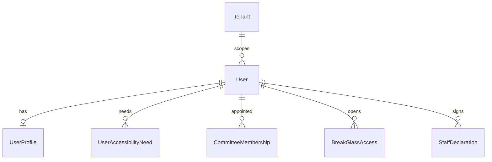
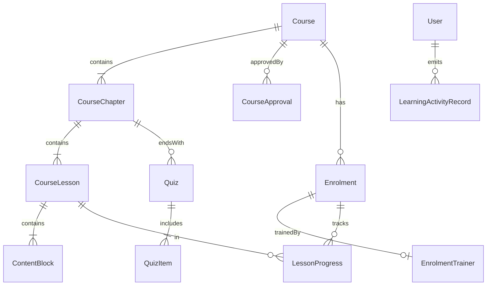
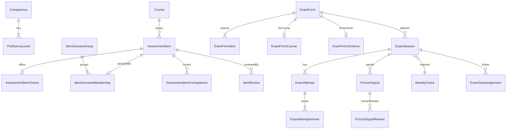
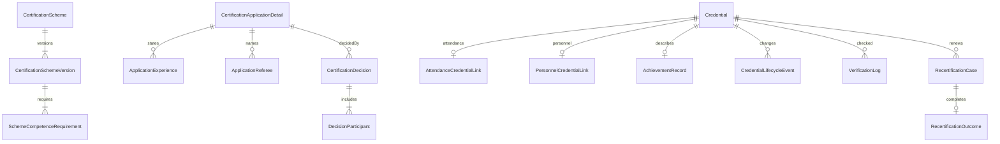
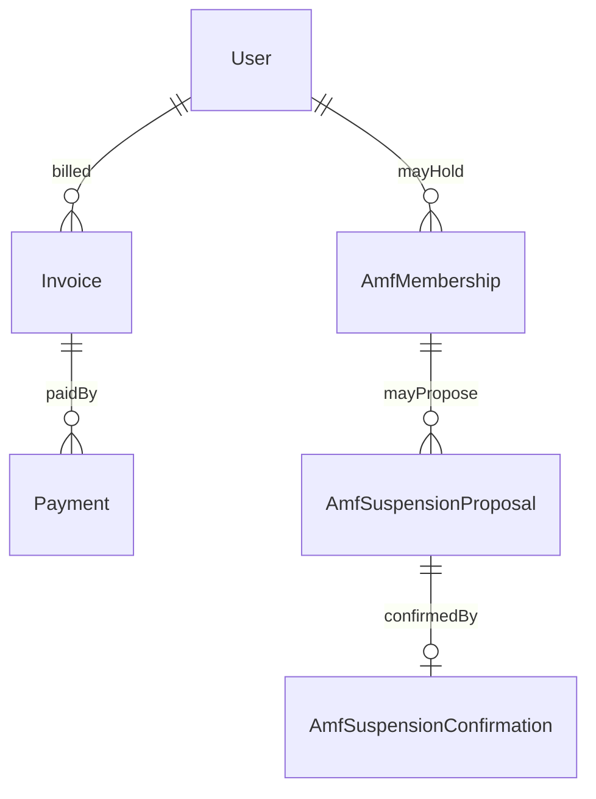
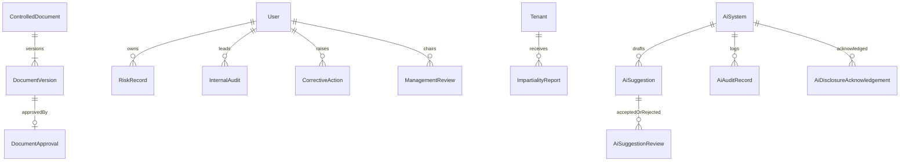

# Model podataka plana proizvoda

**Document ID:** CON-ARCH-PP-DM-001
**Status:** Descriptive
**Date:** 2026-10-19
**Authority:** Subordinate to [OD-PP-01 … OD-PP-14](../governance/OD_PP_PRODUCT_PLAN_DECISIONS_2026-10-19.md) and the Canonical Development Baseline

Ovaj dokument opisuje Prisma modele iz migracije `20261019140000_product_plan_domain_baseline`. Nije dokaz akreditacije. Tekst standarda nije prepisan. Oznake klauzula služe za sljedivost.

Svaka nova poslovna tabela ima `tenantId` i strani ključ na `Tenant` sa `ON DELETE RESTRICT`. Veze prema `User` koriste par `(tenantId, userId)` prema postojećem obrascu `@@unique([tenantId, id])`.

## Ograničenja zamrznutih modela

`User` zadržava skalarna polja `id`, `tenantId`, `email`, `isActive`. Profil, JMBG, telefon, posao i stanje provjere identiteta su na `UserProfile`. Potrebe pristupačnosti (ISO/IEC 24751) su na `UserAccessibilityNeed`.

`CertificationApplication` se ne mijenja. `CertificationApplicationDetail.certificationApplicationId` je logička veza bez stranog ključa, jer bi ključ tražio polje na zamrznutom modelu (PKG-06). Isto važi za `ComplaintCase` i `AppealCase`: nova odluka se na žalbu i dalje veže postojećim tekstualnim `certificationDecisionReference`.

`AuditEvent` i `AuditChainHead` nisu prošireni. Novi moduli i dalje treba da emituju događaje u taj lanac. `AiAuditRecord` je poseban zapis AI upotrebe, ne drugi lanac audita.

`CommitteeMembership.canonicalCode` nije dodjela uloge. Izvor ovlaštenja ostaje vanjski IdP (MD05).

Opcionalne veze koje Prisma ne može izraziti kao djelimično prazan složeni ključ modelovane su zasebnom tabelom (trener upisa, scenario stavke, kurs ili šema ispitnog obrasca, potvrda dokumenta, ishod recertifikacije, potvrda AMF suspenzije).

## 1. Profil, imenovanje i break-glass

| Entitet               | Spec                   | Klauzula / standard                           |
| --------------------- | ---------------------- | --------------------------------------------- |
| UserProfile           | 12.1                   | 17024 6.1, 7.1; JMBG čeka DPIA (29100, 27018) |
| UserAccessibilityNeed | 3.1, 7, 12.1           | 17024 9.1.5; ISO/IEC 24751                    |
| CommitteeMembership   | 11.1                   | 17024 5.1, 6.2                                |
| BreakGlassAccess      | 12, umjesto „sve vidi” | OD-PP-07; Baseline §7.5                       |
| StaffDeclaration      | 11.1                   | 17024 6.1.7–6.1.8                             |

## 2. Obuka i zapis učenja

Kurs slijedi ISO/IEC 8808: kurs, poglavlje (modul), lekcija, blok sadržaja (aktivnost). Obrazovna polja na kursu slijede ISO/IEC 19788-5: jezik, nivo, ciljna grupa, tipično vrijeme, ciljevi. `standardReference` prima oznaku, ne tekst klauzule. `ContentBlock.accessibilityFeatures` prima oznake pristupačnosti sadržaja (ISO/IEC 4932), na primjer titl i alternativni tekst.

Životni ciklus kursa: `DRAFT`, `IN_TC_REVIEW`, `APPROVED`, `PUBLISHED`, `UNPUBLISHED`. Odobrenje tehničkog komiteta i direktora je `CourseApproval`, ne automatski prelazak.

| Entitet                                           | Spec      | Klauzula / standard                                                                 |
| ------------------------------------------------- | --------- | ----------------------------------------------------------------------------------- |
| Course, CourseChapter, CourseLesson, ContentBlock | 1, 2, 6.1 | ISO/IEC 8808; ISO/IEC 19788-5; ISO 29993 / 29994 kao referenca kvaliteta obuke      |
| CourseApproval                                    | 6.1       | 17024 8.5 u dijelu validacije; ISO 21001 8.3 ostaje provizorno jer je izvor oštećen |
| Enrolment, EnrolmentTrainer, LessonProgress       | 2, 2.2    | 17024 5.2.3(e) preko trenera                                                        |
| Quiz, QuizItem                                    | 2.2, 6.1  | ISO 29992 kao referenca procjene učenja                                             |
| LearningActivityRecord                            | 2.2, 12.1 | ISO/IEC/IEEE 39274-1-1 (xAPI); TS 20748-4 za saglasnost analitike                   |

`LearningActivityRecord` je izvor historije. `analyticsConsent` je odvojen od samog zapisa (OD-PP-11).

## 3. Kompetencije, banka stavki i ispit

Jedan tačan odgovor je `AssessmentItem.correctChoiceKey`. Vrijeme po stavci je `timeLimitSeconds`. Slučajni redoslijed je na `ExamForm` (`shuffleItems`, `shuffleChoices`). Trajanje obrasca je `durationSeconds`. Prozor ponovnog polaganja je `retakeWindowDays` sa podrazumijevanih 90 dana.

Ispitna sesija ne može biti upisana bez `rulesAcceptedAt`, `ndaAcceptedAt`, `invigilatorUserId`, `identityCheckId` i `mfaReference`. `IdentityCheck.method` ima samo `HUMAN_VISUAL`. Nema kolone biometrijskog šablona. `ProctorSignal` nema ishod diskvalifikacije. Ljudska ocjena signala je `ProctorSignalReview`.

`EnrolmentTrainer` postoji da bi se trener mogao uporediti sa ispitivačem i nadzornikom (`ExamDutyAssignment`, `ExamSession.invigilatorUserId`). Pravilo „trener ne ispituje svog polaznika” izvršava kasniji servis; šema drži obje strane.

Certifikacijski ispit u runtimeu koristi zasebne tabele (`SchemeExamItem`, `ExamBlueprint`, `StandardSettingRecord`, `AssembledExamForm`, `CertificationExamSession`, `CertificationExamResult`, `ExamCertificationDecision`, `ExamProctorFlag`). Kursna banka `AssessmentItem` ostaje za kviz poglavlja. Njen status `ItemReviewState` je zamrznut na DRAFT / IN_REVIEW / APPROVED / REJECTED, pa tok DRAFT → REVIEW → APPROVED → RETIRED ne mijenja tu enumeraciju.

`CertificationExamSession` čuva `rulesAcceptedAt`, `ndaAcceptedAt`, `invigilatorUserId` i `mfaReference`. `identityCaptureState` ostaje `NOT_COLLECTED_DPIA_PENDING`: slika i nacionalni identifikator se ne prikupljaju dok DPIA nije odobren (OD-PP-05, OD-PP-15). Sesija prelazi u `READY` tek kada nadzornik upiše `IdentityCheck` bez slike: vrsta isprave, provjeravač, vrijeme i metoda `HUMAN_VISUAL`, povezano preko `CertificationExamIdentityLink`. Prozor od 90 dana važi samo nakon neuspjeha (OD-PP-16). Višestruki izbor boduje se samo ako se skup ključeva u potpunosti poklapa (OD-PP-17). `STAFF_SYSADM` nema pristup banci stavki ni odluci (OD-PP-18). Proktorski signal je zapis koji čovjek pregleda; ne mijenja bodove i ne diskvalifikuje. Odluka `ExamCertificationDecision` ne izdaje `Credential`.

| Entitet                                    | Spec    | Klauzula / standard                       |
| ------------------------------------------ | ------- | ----------------------------------------- |
| Competence, ProficiencyLevel               | 6.1, 8  | ISO/IEC 20006-1/-2; 17024 8.2             |
| AssessmentItem i izbori, scenario, pregled | 7, 12.3 | 17024 6.5(b), 7.4.5; ISO/IEC 23988        |
| ExamForm, ExamSession, ExamAttempt         | 3, 7    | 17024 7.4.4, 9.3; ISO/IEC 23988           |
| IdentityCheck                              | 7       | 17024 7.4.4(c); Baseline IAL-2, ne IAL-3  |
| ProctorSignal, ProctorSignalReview         | 7       | 17024 7.4.4(b); AI samo signal (OD-PP-03) |

## 4. Šema, prijava, odluka i isprava

`CertificationPathway` je `CONFORA_TRAINING` ili `EXTERNAL_EQUIVALENT`. Vanjski put nosi `externalEvidenceObjectKey` i ne traži upis. `refereeCount` na verziji šeme podrazumijevano je 2. Polja verzije pokrivaju obim, opis posla, iskustvo, preduslove, sposobnosti, referencu etičkog kodeksa, javni opis procesa, nadzor i recertifikaciju (17024 7.2.2 i 8.2).

`DecisionParticipant` nosi izjavu o sukobu, oznaku da je učesnik trener kandidata i oznaku da bi ispitivao vlastitog polaznika, te da li je provjera čista.

Tri dokumenta ostaju odvojena (OD-PP-19, ISO/IEC 17024:2026 3.6). `EducationCompletionDocument` (EDU) nastaje kad su obavezne lekcije završene i vrijeme tretira kao dokaz učešća. `ExamPassAttestation` (EXM) nastaje nakon položenog ispita i nije profesionalni certifikat. `ExamPersonnelCredentialLink` (CON) nastaje tek nakon odluke i ovlaštenja za izdavanje od druge osobe (OD-PP-23, 9.4.7–9.4.9). `ProfessionalCase` vodi put A `CONFORA_EDUCATION` i put B `DIRECT` pod istim kriterijima (OD-PP-24, 5.2.3). Nivo računa `SchemeLevelCriterion`. `CommitteeProposal` isključuje trenera i ispitivača (9.4.4). Potvrda referenta ne zatvara uslov.

`CommitteeConflictDeclaration` mora postojati, bez prijavljenog sukoba, prije uvida i odluke (OD-PP-26). AI ide samo kroz gateway: stub je podrazumijevan, OpenAI adapter nije odabran, a zapis nosi svrhu, model, kategoriju, jedinice i trošak (OD-PP-27, 6.5). `NoticeJob` i `InAppNotice` nose podsjetnike kroz red; SES se ne povezuje dok DNS nije postavljen i dok ne postoji SNS webhook s provjerom potpisa (OD-PP-28). `SchemeAnnualFee` drži iznos po šemi. Predloženi iznos je 90 EUR. Prva godina je `INCLUDED`. Neplaćanje otvara `AnnualFeeObligation` u `OPEN_CASE` i ne mijenja `Credential.lifecycle` (OD-PP-29).

`Credential.credentialType` je `ATTENDANCE` ili `PERSONNEL`. Potvrda o pohađanju veže se na kurs i upis preko `AttendanceCredentialLink`. Certifikat osobe nakon ispitne odluke veže se preko `ExamPersonnelCredentialLink` na `ExamCertificationDecision` i verziju šeme. `PersonnelCredentialLink` ostaje veza na odluku o prijavi i ne preusmjerava se. Javni identifikator je `publicUid` u obliku `CON-YYYY-NNNN`. `payloadHash`, `signature` i `qrVerifyToken` služe provjeri. Životni ciklus: `ACTIVE`, `EXPIRED`, `SUSPENDED`, `WITHDRAWN`, `SCOPE_REDUCED`. Javni status `VALID` je projekcija `ACTIVE` dok `expiresAt` nije prošao; `SUSPENDED` i `WITHDRAWN` imaju prednost nad istekom. Pretraga registra po imenu zahtijeva `registryListed`, postojeći `registryConsentAt` i `registryConsentRevokedAt` prazan (OD-DIR-33). Opozvan pristanak ostavlja red registra, a nosilac ne ulazi u rezultate. Nedostajući pristanak ne prolazi. Odgovor prijave ne nosi uzastopni broj ni datum isteka. Promjenu statusa radi ovlaštena osoba, uz razlog i zapis u hash lancu. Neplaćeni AMF samo predlaže suspenziju. `RecertificationReminder` (90 dana, 30 dana, na dan isteka) i `CpdRecord` pripremaju recertifikaciju i ne donose odluku.

`AchievementRecord` drži naziv postignuća, ime nosioca, izdavaoca, datum, rezultat, kriterij, jezik i `supplement` za dopunski zapis (ISO/IEC 19479). To su polja CONFORA-e.

`CredentialLifecycleEvent` nosi razlog, ko je potvrdio, kraj suspenzije i rok povlačenja (17024 9.5). AMF nije strani ključ ove tabele.

`VerificationLog` čuva IP, vrijeme, identifikator i rezultat (spec 12.8). Rezultat može biti i `NOT_FOUND`.

| Entitet                                                                   | Spec              | Klauzula / standard         |
| ------------------------------------------------------------------------- | ----------------- | --------------------------- |
| CertificationScheme, CertificationSchemeVersion                           | 4, 8              | 17024 7.2.2, 8.2, 8.5, 9.6  |
| CertificationApplicationDetail, ApplicationExperience, ApplicationReferee | 4.1, 8            | 17024 5.2.3(d), 9.2, 9.7    |
| CertificationDecision, DecisionParticipant                                | 4.2, 8            | 17024 4.2, 9.4; Baseline §7 |
| Credential, AttendanceCredentialLink, PersonnelCredentialLink             | 2.3, 6.1, 8, 12.1 | 17024 9.4.8, 9.4.9, 9.5     |
| AchievementRecord                                                         | 2.3, 12.1         | ISO/IEC 19479               |
| VerificationLog                                                           | 12.6–12.8         | 17024 7.2.1                 |
| RecertificationCase, RecertificationOutcome                               | 8                 | 17024 9.6                   |

## 5. Račun, uplata i AMF

Nijedna tabela iz odjeljka 4 ne referencira `AmfMembership`. Članarina ne otvara ni ne zatvara prijavu (OD-PP-02). Suspenzija nastaje tek redom `AmfSuspensionConfirmation`.

| Entitet                                                         | Spec      | Klauzula / standard             |
| --------------------------------------------------------------- | --------- | ------------------------------- |
| Invoice, Payment                                                | 2.1, 11.2 | naknada šeme, ne uslov članstva |
| AmfMembership, AmfSuspensionProposal, AmfSuspensionConfirmation | 2         | 17024 4.3.6, 9.5                |

## 6. Upravljanje i AI

`ImpartialityReport` nema `userId`. Anonimna prijava ostaje bez veze na korisnika. `followUpTokenHash` je heš tokena za nastavak, ne identitet.

`RiskRecord` čuva `likelihood`, `impact` i `band` (`GREEN`, `YELLOW`, `RED`). Umnožak računa servis i upisuje pojas; šema ne tvrdi da je pojas već provjeren.

`DocumentVersion.nextReviewAt` je datum sljedeće revizije. Odobrenje je zaseban red `DocumentApproval`.

`AiSuggestion.isAiGenerated` je podrazumijevano istinito. Prihvatanje ili odbijanje je `AiSuggestionReview` (Accept AI Suggestion). `AiAuditRecord` čuva vrijeme, aktera, model, heš upita, referencu ulaza i heš izlaza. `AiDisclosureAcknowledgement` je potvrda kandidata po verziji obavještenja. `AiSystem.aiiaReference` pokazuje na AIIA, a ne sadrži samu procjenu.

| Entitet                                                                                | Spec                        | Klauzula / standard                |
| -------------------------------------------------------------------------------------- | --------------------------- | ---------------------------------- |
| ControlledDocument, DocumentVersion, DocumentApproval                                  | 11.3                        | 17024 10.7                         |
| ImpartialityReport                                                                     | 11.4                        | 17024 4.3                          |
| RiskRecord                                                                             | 11.5                        | 17024 4.3.1–4.3.10, 10             |
| InternalAudit                                                                          | 11.6                        | 17024 10; ISO 21001 9.2 provizorno |
| ManagementReview                                                                       | 11.7                        | 17024 10                           |
| CorrectiveAction                                                                       | 11.8                        | 17024 10                           |
| AiSystem, AiSuggestion, AiSuggestionReview, AiAuditRecord, AiDisclosureAcknowledgement | 2.4, 3.2, 6.1, 7, 12.3–12.5 | 17024 4.3.5, 6.5; ISO/IEC 42005    |

## Šta ovaj model namjerno nema

- API, sučelje, emiter xAPI zapisa i tok izdavanja.
- Strani ključ sa detalja prijave na `CertificationApplication`.
- Tabelu koja dodjeljuje RBAC ulogu.
- Biometrijski šablon, metodu koja nije `HUMAN_VISUAL`, i automatsku diskvalifikaciju.
- Vezu članarine na prijavu ili ispravu.
- Tekst ISO standarda.
- VR/AR strukture (ISO/IEC 9234 nije u obimu).
